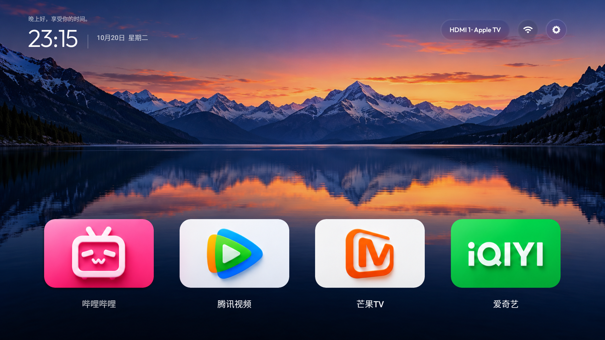

# 静境 TV · Quiet TV

> 当前分支为 **5.4-rc1 / 机内初始化向导候选版**，保留 API 19 兼容改动。新向导尚未完成微鲸真机全流程验证，Android 4.4 运行验证也未完成。[向导使用与限制](docs/ON_DEVICE_SETUP.zh-CN.md) · [4.4 兼容说明](docs/ANDROID44.md)。下文 5.2 的实机记录属于历史版本；稳定版本仍在 main 分支。

给老电视做一个简洁、适合遥控器的原生桌面。借鉴 tvOS 的横向卡片、低位 Dock 与玻璃材质，保留壁纸的视觉空间。

当前版本 **5.2 / versionCode 9**。已在微鲸 **65D2UT / HELIOSR-02.08.03 / Android API 21** 上测试。通用桌面界面面向 Android 5.0 及以上；HDMI、系统设置和系统包管理部分为该固件专用适配，其他电视未验证。

[下载 APK](https://github.com/titi14gj/quiet-tv/releases/latest) · [从设计到上机的完整教程](docs/TUTORIAL.zh-CN.md) · [素材与授权](THIRD_PARTY_NOTICES.md)



## 能做什么

- 首页四个横向常用应用；向下展开第二排四个快捷应用。
- 第二排下方显示“向下打开所有应用”，再按下进入独立应用页，返回时记住焦点。
- 支持长按调整 Dock、遥控方向导航、中文标签和滚动列表。
- 内置纯黑与应用主题色光晕、原创 mac 风格壁纸、山湖暮色壁纸。
- 右上角为输入标签、网络、设置；焦点缩放预留空间，玻璃材质使用壁纸取样与 Canvas 高光。
- 在已测试微鲸固件上读取 HDMI 连接与 CEC 名称，例如“HDMI 1 — Apple TV”，并通过厂商播放器切换输入。

[第二排与入口截图](docs/screenshots/shortcuts.png) · [所有应用截图](docs/screenshots/all-apps.png) · [信号源截图](docs/screenshots/inputs.png)

## 快速安装

从 Releases 下载 APK，可以使用 U 盘和电视文件管理器安装。5.4-rc1 新增可选的[机内初始化向导](docs/ON_DEVICE_SETUP.zh-CN.md)，网络 ADB 已开放时可在电视上授权并管理已适配的系统包。也可以继续用电脑安装：启用电视 ADB 调试，并确认电脑与电视处于同一网络。以下地址为示例，请替换成自己的电视地址。

```sh
TV=192.168.1.100:5555
adb connect "$TV"
adb -s "$TV" install -r QuietTV-5.2.apk
adb -s "$TV" shell am start -n cn.quiet.tv/.MainActivity
```

部分电视会显示安装确认框，需要在电视上确认。安装完成不等于已经替换默认桌面；请先确认桌面、系统设置和信号源都能正常打开，再阅读教程中的[桌面接管](docs/TUTORIAL.zh-CN.md#5-接管桌面)步骤。

## 本机构建

需要 JDK 17、Android SDK Platform 33、Build Tools 33.0.0，以及可用的 `adb`。项目用原生 Java / Canvas / Android View，不依赖 AndroidX 或 Gradle。

```sh
export JAVA_HOME=/path/to/jdk-17
export ANDROID_HOME=/path/to/android-sdk
bash build.sh
```

产物为 `build/QuietTV.apk`。默认构建会在 `.local/` 生成仅用于本地开发的签名密钥；它与 Releases APK 的签名不同，不能直接覆盖已安装的发布版。自有签名、版本更新和构建细节见[教程](docs/TUTORIAL.zh-CN.md#3-构建-apk)。签名密钥不在仓库中。

## 项目结构

| 路径 | 用途 |
| --- | --- |
| `src/cn/quiet/tv/` | 桌面、焦点导航、壁纸、图标和微鲸输入适配 |
| `assets/`、`res/` | APK 实际使用的素材与资源 |
| `design/` | 历史浏览器样稿、可编辑图标与导出脚本；与 5.2 原生界面存在差异 |
| `admin-src/` | 可选的 ADB shell 诊断工具，不是常驻应用 |
| `scripts/` | 显式指定设备的恢复脚本 |
| `docs/` | 中文教程与实机截图 |

## 实际限制

- 该电视的桌面当前由 **1920×1080** 合成；屏幕面板为 4K 不代表系统桌面原生 4K。默认山湖素材为 1672×941，不宣称 4K 原图。
- 玻璃效果为适配 API 21 的壁纸取样近似，不是 Apple 的完整 Liquid Glass 或系统实时背景折射。
- 应用页列出有启动入口的应用，不包含所有后台服务。实机截图中的应用数量仅代表测试电视当时的安装状态。
- 系统包限制只覆盖已确认的独立广告组件，不能保证消除播放器内嵌广告、其他应用广告或固件开机画面。
- 没有云端账户、统计上报或自动更新功能；5.4-rc1 为可选的本机 ADB 连接申请 INTERNET 权限，客户端只连接 127.0.0.1，不上传设备与应用清单。打开第三方应用后的网络行为由对应应用决定。

## 致谢与许可

本项目借鉴并适配 [Gathin 的 CleanYourTV](https://github.com/Gathin23/cleanyourtv)，保留 MIT 署名与授权；Outfit 字体按 SIL OFL 1.1 分发。项目代码采用 MIT。品牌标识和第三方素材的适用范围见 [THIRD_PARTY_NOTICES.md](THIRD_PARTY_NOTICES.md)。本项目与 Apple、微鲸及所展示的应用品牌无隶属关系。
