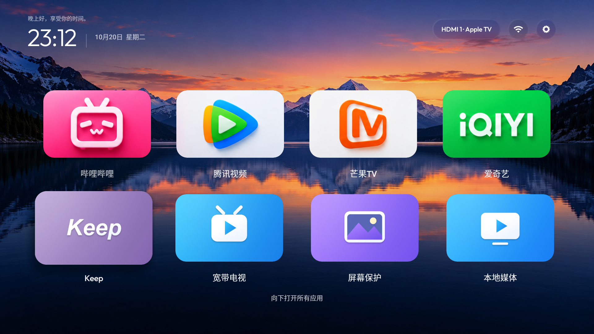
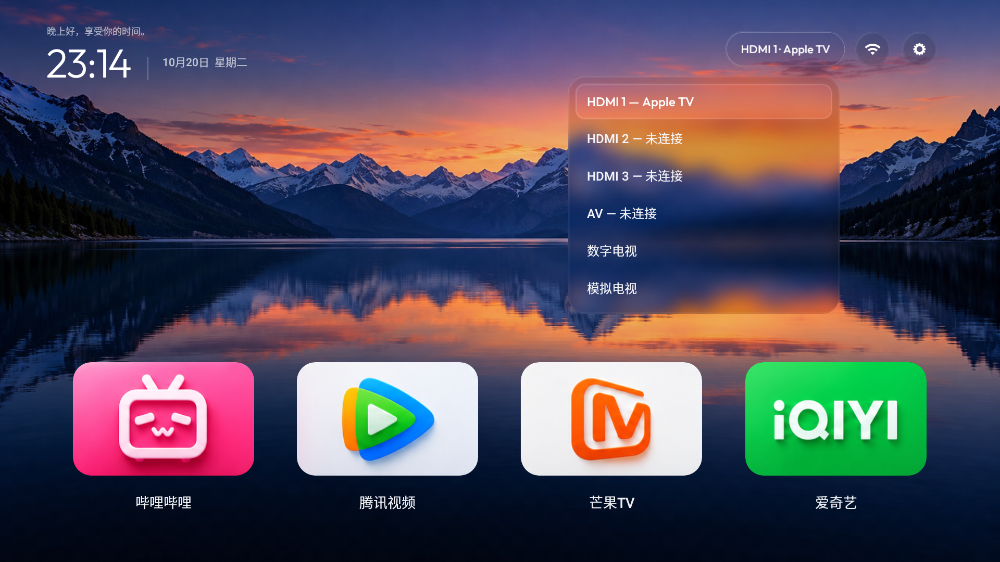

# 给老电视换一个简洁桌面：静境 TV 从设计到上机

这篇教程记录一个实际完成的改造：在微鲸 65D2UT 上，用适配旧系统的原生桌面替代臃肿的出厂桌面，加入横向卡片、壁纸设置、真实 HDMI 设备名称和可恢复的广告组件限制。

教程对应 **静境 TV 5.2（versionCode 9）**。测试固件为 HELIOSR-02.08.03，Android API 21，内核 3.10.40。系统 release 属性与 fingerprint 中的小版本不完全一致，兼容判断以实际 API 和接口测试为准。其他型号不能仅凭“也是 Android 5”照搬厂商相关步骤。

## 1. 先定交互，再处理系统替换

一开始最容易走偏的地方，是只换一张壁纸、把图标画圆，然后希望它看起来像 Apple TV。真正影响使用的是信息层级、遥控路径和焦点行为。

我们最终采用的结构是：

1. 默认首页只显示四个常用应用，放在较低位置，把中间留给壁纸。
2. 按下，展开第二排四个快捷应用；第一排仍在，方便理解当前位置。
3. 第二排下方出现“向下打开所有应用”，再按下进入独立的全应用页。
4. 全应用页按返回，或在首行按上，回到原来的快捷应用；重新进入时保留全应用页的选择。
5. 右上角固定为输入标签、网络、设置。不要把网络名称等长文本全挤进顶栏。

卡片使用横向比例，不使用手机桌面的方形图标。应用名单独放在卡片下方并水平居中。焦点效果由放大、轻微抬升、前景位移和高光组成，避免用一大块纯白遮住内容。



“所有应用”指有启动入口的应用，不是系统里每个安装包或后台服务。5.2 实机当时发现 15 个可启动应用；你的数量会不同。

## 2. 为什么使用原生 Java / Canvas

旧电视的限制不只是 Android 版本：GPU、合成分辨率、系统服务和遥控焦点规则也有差异。这个实现保持 API 21 兼容，使用系统 View、Canvas 和属性动画，不依赖 AndroidX。

核心文件：

| 文件 | 负责什么 |
| --- | --- |
| `MainActivity.java` | 页面布局、应用发现、遥控导航、焦点记忆、设置与壁纸菜单 |
| `TvIcon.java` | 原生图标绘制与未知应用的回退 |
| `NativeArtwork.java` | 已匹配应用的底板、独立前景和品牌样稿绘制 |
| `GlassSurface.java` | 壁纸取样、模糊、透镜缩放、渐变边缘和高光 |
| `WhaleyInputs.java` | 已测试微鲸固件的 HDMI 连接状态与 CEC 名称读取 |

桌面设计借鉴并适配了 [CleanYourTV](https://github.com/Gathin23/cleanyourtv)，上游参考提交为 `7377a9be8ca0b33af6fea006230414582fd150bd`。复用内容及授权见 [素材说明](../THIRD_PARTY_NOTICES.md)。

### 图标如何保持清晰

其他入口的图标在 `design/catalog.js` 中保存为可编辑的矢量设计。导出脚本生成 960×600 的透明前景，原生代码再分别绘制渐变底板、前景与焦点光泽。这样可以独立调整颜色与景深。

首页四个品牌卡片目前仍取自生成样稿的位图区块，不能把它们描述成全部重新建立了独立矢量前景。未匹配应用走回退绘制；新增应用需要补充包名与图稿。

如需重新导出图标，在项目根目录执行：

```sh
npm install --no-save --package-lock=false sharp
node design/export-icons.cjs
```

这一步不是构建 APK 的前提，现成导出素材已经包含在仓库中。

### 玻璃质感与焦点裁切

旧版 Android 没有现代系统实时背景模糊接口。这里先把壁纸降采样并模糊，再在控件内取样，叠加轻微透镜缩放、饱和度、渐变高光和边缘光。它是适配旧电视的玻璃近似材质，不是完整的 Apple Liquid Glass。

曾遇到一个很迷惑的问题：设置圆钮离屏幕边缘还有距离，选中放大后，右侧却被削平。实机截图和布局代码确认是**父布局边界裁切**，而不是电视 overscan。

修复包括：对顶栏祖先布局设置 `clipChildren=false`、`clipToPadding=false`，并在三个控件外预留 10dp 余量。保留放大效果，而不是把按钮缩回去掩盖问题。

[修复前](screenshots/settings-before.png) · [修复后](screenshots/home.png)

全应用滚动区则相反：它必须在自己的视口内裁切，否则滚动中的旧行会盖住固定标题。焦点区域需要留白，列表内容需要边界，两者不能统一设成全部不裁切。

### 4K 面板不等于 4K 桌面

测试电视的面板为 4K，但桌面实际由系统以 1920×1080 合成。改大图片或 Canvas 尺寸不会自动改变系统合成分辨率。本项目没有强行更改 `wm size` 或系统显示配置。

默认山湖壁纸为原创生成素材，尺寸 1672×941，按比例覆盖显示；其他 mac 风格壁纸也是原创生成，不是 Apple 原图。当前不宣称原生 4K 壁纸或原生 4K 桌面。

## 3. 构建 APK

准备：JDK 17、Android SDK Platform 33、Build Tools 33.0.0、ADB，以及 `zip`。Linux/macOS 可直接使用仓库脚本。

```sh
export JAVA_HOME=/path/to/jdk-17
export ANDROID_HOME=/path/to/android-sdk
bash build.sh
```

流程为 `aapt → javac → d8 → 打包 → zipalign → apksigner`，最终产物是 `build/QuietTV.apk`。编译时使用 SDK 33，但 Manifest 的 minSdkVersion 为 21，代码必须继续避免调用较新的运行时 API。

默认脚本在 `.local/development.jks` 生成开发签名，不会把密钥加入 Git。**发布版 APK 与自行编译的开发版签名不同，不能直接覆盖安装。** 不要为了覆盖而随意卸载；卸载会丢失本应用的设置，也可能暂时失去唯一可用桌面。需要长期自行维护时，先规划自己的包名与签名。

使用自有密钥时（以下交互式密码示例在 Bash 中执行）：

```sh
export QUIETTV_KEYSTORE=/secure/path/my-release.jks
export QUIETTV_KEY_ALIAS=my-alias
read -r -s -p 'Keystore password: ' QUIETTV_STORE_PASSWORD
printf '\n'
export QUIETTV_STORE_PASSWORD
# 如果私钥密码不同，另外设置 QUIETTV_KEY_PASSWORD。
bash build.sh
unset QUIETTV_STORE_PASSWORD QUIETTV_KEY_PASSWORD
```

保持同一包名、同一签名，更新 Manifest 的 versionCode 和 versionName，再构建升级包。仓库没有发布签名私钥。

## 4. 安装，并先验证基础功能

从 GitHub Releases 下载 APK，或使用自己构建的产物。电视启用 ADB 调试，并与电脑处于同一网络。示例地址应替换成自己的电视地址：

```sh
TV=192.168.1.100:5555
adb connect "$TV"
adb devices
adb -s "$TV" install -r QuietTV-5.2.apk
adb -s "$TV" shell am start -n cn.quiet.tv/.MainActivity
```

部分厂商系统会弹出安装确认框，需要在电视上确认。在处理原厂桌面前，先完成这些验证：

- 方向键、确认、返回、长按调整 Dock 都能操作。
- 首页向下展开快捷应用；再向下进入所有应用；返回和焦点记忆正确。
- 壁纸菜单可以打开，切换后返回仍能保存。
- 系统设置和网络设置可以从新桌面打开。
- 连接设备时，信号源读取和切换正常。

包名为 `cn.quiet.tv`，桌面入口为 `cn.quiet.tv/.MainActivity`。备用电脑应保持 ADB 可用，以便恢复原厂包。

## 5. 接管桌面

以下是**测试微鲸固件上的实际做法**，不是所有电视通用的命令保证。

### 为什么仅设置默认桌面无效

本机可以成功写入静境 TV 的 HOME 首选记录，但实际按 Home 仍回原厂桌面。本机框架的解析逻辑会在原厂桌面可用时优先返回 `com.helios.launcher`，因此不能把“首选记录写入成功”当作接管成功。

`pm disable-user` 在这台固件上被权限检查拒绝。继续核查发现，系统接受另一个操作 `pm hide`。它把包设为当前用户不可用，影响系统的组件解析；**与在自制桌面里不显示图标不同**。

### 实际操作

先确认静境 TV 已能独立启动，然后：

```sh
adb -s "$TV" shell pm hide --user 0 com.helios.launcher
adb -s "$TV" shell am start -n cn.quiet.tv/.MainActivity
adb -s "$TV" shell input keyevent 3
adb -s "$TV" shell dumpsys package com.helios.launcher
adb -s "$TV" shell dumpsys activity activities
```

检查用户 0 的状态是否为 `hidden=true`，以及 `mResumedActivity` 是否为 `cn.quiet.tv/.MainActivity`。APK 和应用数据仍保留；`enabled=0` 仍可能显示为默认状态，因此不要写成 `disable-user` 成功。

测试机在隐藏后仍残留旧进程；即使 force-stop 读回 `stopped=true`，也不能据此认定旧进程已经退出。最终通过一次正常重启验证：

```sh
adb -s "$TV" reboot
# 等电视正常启动、网络恢复后再连接；网络 ADB 可能暂时显示 offline。
adb connect "$TV"
adb -s "$TV" shell getprop sys.boot_completed
adb -s "$TV" shell dumpsys package com.helios.launcher
adb -s "$TV" shell dumpsys activity activities
adb -s "$TV" shell ps
```

本机实测：启动完成后自动进入静境 TV，原厂桌面 `hidden=true` 保留，进程列表中不再出现原厂桌面。`stopped` 在启动后变回 false，所以核心证据是包不可用状态、实际 HOME 行为和进程情况。未来厂商升级或恢复出厂后的状态没有验证。

恢复原厂桌面：

```sh
adb -s "$TV" shell pm unhide --user 0 com.helios.launcher
adb -s "$TV" shell am start -a android.intent.action.MAIN -c android.intent.category.HOME
```

本机框架会再次优先选择原厂桌面。若 `hide` 被拒绝，或读回状态没有变化，应停止这一步，不要删除系统 APK、清空应用数据或照搬别的机型包名。

## 6. 处理已确认的独立广告包

测试机确认的两个独立广告包为：

| 包名 | 用途 |
| --- | --- |
| `com.helios.ad.service` | 厂商广告服务 |
| `cn.whaley.adsys` | 厂商广告包 |

先查询包，确认存在且与固件一致，再执行：

```sh
adb -s "$TV" shell pm hide --user 0 com.helios.ad.service
adb -s "$TV" shell pm hide --user 0 cn.whaley.adsys
adb -s "$TV" shell dumpsys package com.helios.ad.service
adb -s "$TV" shell dumpsys package cn.whaley.adsys
```

本机正常重启后，两个包的 `hidden=true` 保留，进程未再次出现。此前还按包限制了悬浮窗、通知、Toast 和唤醒锁 AppOps；这些限制本身不足以证明停用成功，因此最终以系统包状态和重启后的运行情况为准。

多个厂商包共享系统 UID 1000。不要因为广告包使用该 UID 就对 UID 1000 整体封网或撤权限，这会波及设置、网络、输入等系统能力。

这一步没有承诺清除所有广告：播放器直接绘制的片头、第三方应用内嵌广告，以及开机阶段的 native/固件画面，需要分别定位。不要为了“全清理”把播放器、系统服务和名字不熟悉的包一起停用。

一次恢复本教程处理过的三个原厂包：

```sh
bash scripts/restore-factory-packages.sh "$TV"
```

它只恢复包的可用状态，不恢复其他独立设置。脚本不会自动修改当前连接的任意设备，必须传入地址或序列号。

## 7. HDMI 名称要从真实设备读取

“HDMI 1 / 2 / 3”只是端口，连接的设备名称需要从 HDMI-CEC 信息读取。静境 TV 的微鲸适配会分别处理未连接、已连接但未识别名称、状态读取失败，避免把每个端口都写成固定设备名。

`WhaleyInputs.java` 使用该固件的 `WTV_API_SERVICE` Binder 接口读取状态；项目不打包厂商 JAR 或 APK。切换则调用厂商已导出的播放器入口：

- action：`com.whaley.tv.tvplayer.ui.START_TV_PLAYER`
- `inputSrc`：HDMI1=4、HDMI2=5、HDMI3=6、AV=7、数字电视=2、模拟电视=1。

这些编号和事务格式是设备专用的，其他固件需要重新确认。普通电视的桌面 UI 可以使用，但此厂商适配不保证通用。



## 8. 关闭自动屏保

测试机通过原厂屏保设置把触发时间设为“永不”，对应的 `system/screen_off_timeout` 为 `2147483647`，并关闭三个 Dream 自动触发开关：

```sh
adb -s "$TV" shell settings put system screen_off_timeout 2147483647
adb -s "$TV" shell settings put secure screensaver_enabled 0
adb -s "$TV" shell settings put secure screensaver_activate_on_sleep 0
adb -s "$TV" shell settings put secure screensaver_activate_on_dock 0
```

先读取并保存自己的原值；本例不是 Android 所有设备统一的“永不”定义。这只关闭自动触发，没有卸载屏保应用，也没有修改电源键、待机唤醒或定时关机。原始测试未进行专项长时间闲置验证，不承诺所有厂商机制都受这些键控制。

测试机原值是 5 分钟和三个开关均为 1，可用 `scripts/restore-screensaver.sh` 恢复；其他设备应按自己的原值恢复。

## 9. 最后怎样验收

我们实际做过的验收包括：安装版本读回、设置按钮焦点截图、双排与全应用页切换、返回焦点记忆、全应用末行滚动、系统设置启动、HDMI-CEC 设备名读取，以及原厂桌面和两个独立广告包在一次正常重启后的状态。

[全应用页](screenshots/all-apps.png) · [滚到末行仍保留标题与顶栏](screenshots/all-apps-bottom.png)

不要只看命令是否退出成功。对系统改造，至少分别确认：配置是否写入、功能是否按预期工作、重启后是否仍生效。把“隐藏列表中的图标”“系统包对当前用户不可用”“进程已退出”“广告全部消失”当成不同的结论，证据支持到哪一步，就写到哪一步。

后续更新只需安装同签名的新 APK；无需重复隐藏原厂包。保留可用的恢复通道和原始签名私钥，比每次都重新折腾系统更有价值。
